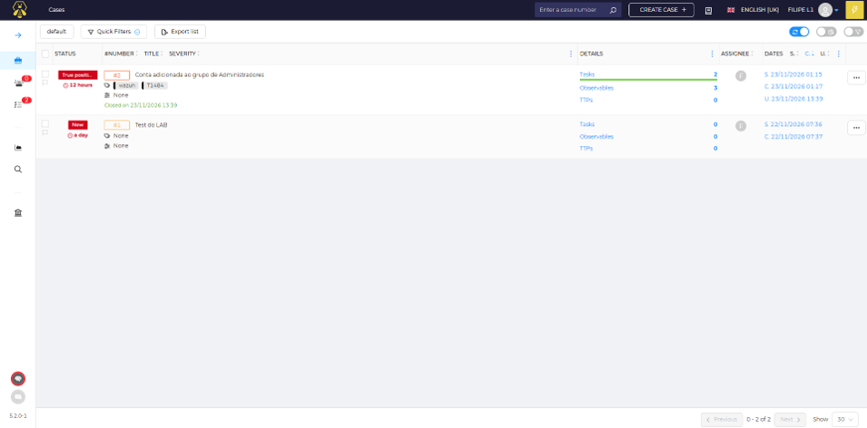

## Triagem de alertas (simulação de L1)

### Simulação

No PowerShell como administrador, criei uma conta e promovi-a a administrador, e corri comandos de reconhecimento:

```powershell
net user labtest <palavra-passe-de-teste> /add
net localgroup Administradores labtest /add
```

### Alerta

## Casos de Triagem
- [Caso 01 — Conta adicionada ao grupo de Administradores (Wazuh Rule 60154)](casos/01-administradores-labtest.md)

| Campo | Valor |
|---|---|
| Regra | 60154, Administrators Group Changed |
| Nível | 12 |
| Técnica MITRE | T1484 |
| Evento do Windows | 4732 |
| Computador | win-lab |
| Quem fez | epcps |
| Grupo alterado | Administradores |
| Quem entrou | `S-1-5-21-1105318813-943618807-4205460125-1018` (conta `labtest`) |
| Hora | 23/11/2026, 00:29 |

### Triagem

### Triagem

- **O que foi detetado:** A conta `labtest` (`S-1-5-21-1105318813-943618807-4205460125-1018`) foi adicionada ao grupo `Administradores` no computador `win-lab` pela conta `epcps`, gerando o evento do Windows `4732` e o alerta da regra `60154` (`Administrators Group Changed`, nível 12, técnica MITRE `T1484`) às 00:29 do dia 23/11/2026.
- **É esperado?** Sim, porque a ação foi executada por mim no laboratório (`epcps`) para testar a deteção de alterações a grupos privilegiados.
- **Risco se não a reconhecesse:** Se não tivesse sido autorizada, significaria que uma conta com privilégios administrativos estava a criar ou a promover uma nova conta para obter acesso administrativo persistente no sistema.
- **Decisão:** Atividade autorizada de laboratório (não é um incidente real). Num ambiente real, trataria este alerta de nível 12 com prioridade elevada até confirmar junto da administração/IT se a alteração era legítima.
- **Próximos passos:** Validar se não houve mais ações inesperadas na máquina `win-lab`, remover a conta de teste `labtest` quando o teste terminar e registar a conclusão da triagem no caso do TheHive.


### Caso no TheHive

Abri o caso **#2 — Conta adicionada ao grupo de Administradores** no TheHive com severidade **High**, `TLP:AMBER` e as tags `wazuh` e `T1484`. Registei os três observáveis principais da triagem (`win-lab`, `labtest` e o SID `S-1-5-21-1105318813-943618807-4205460125-1018`) e executei as duas tarefas de resposta (validar a autorização da atividade e remover a conta de teste). Encerrei o caso como **True positive** sem impacto real no sistema, documentando que se tratou de uma simulação controlada de laboratório.



### O que mostra este exercício

Este exercício demonstra o fluxo completo de triagem de um analista SOC L1: partir de uma ação no endpoint, analisar o evento do Windows (`4732`) e o alerta gerado no Wazuh (`regra 60154`, nível `12`), avaliar o contexto para confirmar se a atividade era autorizada e gerir todo o ciclo de investigação, remediação e encerramento no TheHive. Mostra também que um alerta de severidade elevada exige investigação e contexto antes de se declarar um incidente real.
